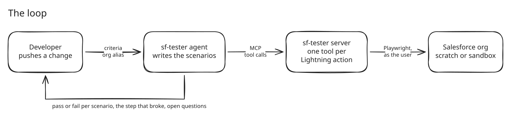
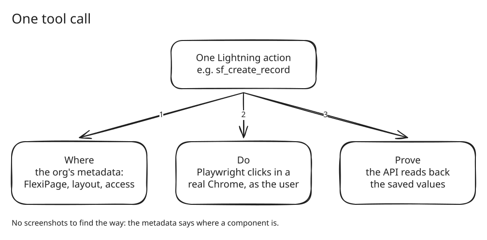
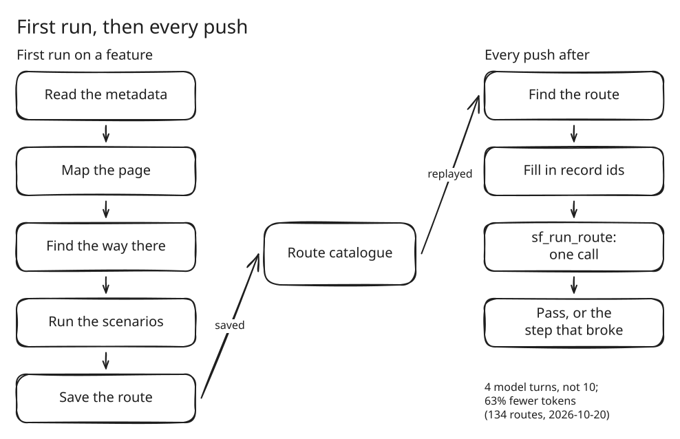

# sf-tester reference

This page holds the detail that the [README](../README.md) leaves out. Start with the README to install sf-tester and run a first test.

## Contents

- [How it works](#how-it-works): the loop, and what one tool call does
- [First run, then every push](#first-run-then-every-push): saved routes, promotion, and the check before a replay
- [What it refuses, and why](#what-it-refuses-and-why)
- [Experience Cloud sites](#experience-cloud-sites): why a site cannot be tested yet
- [What is in the repo](#what-is-in-the-repo)
- [Setup](#setup): what the install commands rely on, and the optional pane
- [Running a test](#running-a-test): the brief, headed runs and production orgs
- [Verify a metadata change with no browser](#verify-a-metadata-change-with-no-browser): the six check kinds, `--matrix`, `--cascade` and the cascade map
  - [Tested versions](#tested-versions)
- [Replay in CI](#replay-in-ci): the replay flags, `--since`, `validity`, personas, `--baseline` and placeholders
  - [This repo's validation org](#this-repos-validation-org)
- [All tools](#all-tools): the 51 tools with their safety class, and the `sf_start` parameters
- [Error codes](#error-codes)
- [Environment variables](#environment-variables)
- [Tests](#tests)

## How it works



You give the agent an org and the requirements. It turns each requirement into positive and negative
scenarios, runs them through the sf-tester server as the users they are about, and hands back what passed, what
failed and the step that broke.



Salesforce is metadata driven, so the paths come from metadata. The FlexiPage says which tab a component sits on,
the layout says which fields are required, and the object says what each user can do. Each Lightning action (open a
record, create one, set fields, save, click a button in a component) is one MCP tool, so a test is built from small
known pieces. Playwright does the clicks in a real Chrome, and the proof comes from the saved data, not from what
the page seemed to show.

Each check is recorded with the oracle that proved it, and `sf_scenario` `end` returns the checks it made.

## First run, then every push



The first run on a feature is the expensive one. A scenario that passes saves its route to your catalogue, with the
persona it ran as, when the run sent its plan and the scenario opened its own page and checked something on it. A
saved route is a draft, a `candidate` in the catalogue: it keeps the run as it happened, dead ends and literal values included, so replays and CI
skip it until it is promoted to `tested`.

`SF_TESTER_PROMOTE` sets who promotes. It defaults to `auto`, which lets the tester promote a route it judges sound when it saves
the route with `sf_save_route` and `promote`. `manual` leaves every route to a person, who promotes it with `sf_promote_route`. An unknown
value reads as `manual`, and the result carries a warning. A persona route and a remap are always held as a candidate for a
person. Promotion by code (dead ends cut, literals as placeholders, one green replay with no model) is not built yet.

After promotion, a rerun is one `sf_run_route` call with the record ids filled in. In the benchmark run of 2026-10-20 (6 routes, 3 runs each, 18 runs per arm), a generic Playwright MCP agent took 12 model turns and 460k tokens,
sf-tester exploring took 10 and 455k, and sf-tester replaying the saved route took 4 and 169k. The benchmark is in [bench](../bench/README.md).

Before a saved route runs, `sf_run_route` checks it against the org with no browser: the hash of its app, of the
FlexiPage it ends on, and of what each persona permission set grants (object, field, tab, Apex class, Visualforce
page, custom permission, flow, app and system permissions, by name, so a catalogue still checks on another org). A
standard profile's own grants differ between a scratch org and a Developer Edition org, so its hash holds only on the
kind of org it was read on. That decides what happens next:

| Check | What happens |
|---|---|
| valid | It replays, with no model. |
| stale | No step runs. `sf_run_route` refuses with `STALE_ROUTE` and names what changed; the CLI replay skips the route with that reason. The agent remaps it: it finds the route again, and the passing scenario saves a new draft whose `replaces` names the stale route (a negative scenario saves no draft, so the agent remaps in a positive scenario of its own). The stale route stays as it is until a person promotes a draft with `sf_promote_route`, which retires it to `replaced` in the catalogue. A different remap of the same route waits beside the first as a draft of its own; once one is promoted, `sf_promote_route` refuses the other with `ALREADY_REPLACED`, and the tester runs that remap again. |
| unknown | The check compared nothing: no validity was saved, or it holds only a page with no FlexiPage, or only a persona saved before permission sets were hashed, or a persona with no permission sets and no app or page (`nothing saved has a hash to compare`). Or the check could not run: the org answered with an error or not within 20 s, or the saved validity is a shape this version cannot read. It replays, and the result says `unknown` and lists why. A route with an app or a FlexiPage to compare is `valid` for that, and lists a persona set saved with no hash as unchecked. |
| none | No saved route: the agent finds one, and the passing scenario saves it as a draft. |

The form is not in the check before the run: its fields come from the UI API as the persona sees them, which needs the
persona's page. It is still compared where the route ends. `replay --baseline` runs a stale route anyway, to read a
new baseline once a person accepts the change.

A route that goes red is the result you want: the step that broke is the first place to look in the build. Gaps the
agent hits in its own tools go to an improvements log, so the next run reuses the workaround.

The diagrams are Excalidraw files: open one in Excalidraw to edit it.

## What it refuses, and why

- **Changing what it tests.** The tester agent never deploys, never edits metadata and never edits code. A tester
  that can fix the build can also hide what is wrong with it. `verify` runs a check-only validate, which saves
  nothing in the org.
- **Finding its way by screenshot.** Screenshots are for pixel questions only. Metadata says where a component is;
  a screenshot only shows where it seemed to be on one run.
- **Working around an error.** A coded error such as `FIELD_NOT_EDITABLE` or `RECORD_UNAVAILABLE` is reported as
  the finding. Going around it would test something other than what a user gets.
- **A user whose Lightning language is not English.** `UNSUPPORTED_LANGUAGE`: sf-tester finds Lightning's own
  controls by their English names (Edit, Save, Close).

## Experience Cloud sites

The roadmap is in the [README](../README.md#roadmap). This section says why sf-tester cannot test a site today.

- **Experience Cloud (digital experience) sites.** Not tested yet, and sf-tester cannot drive one today: every tool
  opens a `/lightning/` path on the internal domain, and a site runs on its own domain. Testing as an external user
  needs "Log in to Experience as User" from the contact record, which takes permissions not every developer has. And
  `ExperienceBundle` and `DigitalExperienceBundle` metadata is a different shape from the FlexiPages the metadata map
  reads from the org, so the map does not cover a site's pages.

## What is in the repo

- `src/server.js` and the modules beside it: the MCP server (`sf_open_record`, `sf_set_fields`, `sf_save`, `sf_click`, `sf_measure`, `sf_run_route` and the rest).
- `agents/sf-tester.md`: the tester agent for Claude Code.
- `src/combinations.json`: UI combinations with a checked route, so an agent does not explore them again.
  `src/cli.js replay` runs them with no model, for CI.
- `src/verify.js`: `src/cli.js verify`, checks of a metadata change with no browser and no model.
- `claude-mod/`: an optional Claude Code pane that shows each running tester's scenarios and steps.
- `bench/`: the benchmark that compares a known route, free exploration and a generic Playwright driver.
- `docs/`: this reference, and the diagrams above.
- `test/`: the tests, and `test/fixture`, the scratch org metadata they run against.

## Setup

The install commands are in the [README](../README.md#install). This section holds the detail behind them.

You need Node 22.10 or later, the Salesforce CLI logged in to your org, and Google Chrome.

The agent file lists `ToolSearch`, so the tester loads each tool's schema when it first needs it instead of all at the
start: about 17k fewer tokens of starting context, and 17% to 37% fewer cache-read tokens per run on the bench. This
relies on Claude Code's tool search, measured with CLI 2.1.319 and its default settings; a setting that turns tool
search off loads every schema at the start again.

Link the agent rather than copy it: it finds `agents/guard.js`, which keeps a tester off the benchmark's answer key,
through that link.

No Chrome? Set `SF_TESTER_BROWSER=chromium` and run `npx playwright-core install chromium`.

The pane is optional:

```
claude plugin marketplace add "$PWD/claude-mod"
claude plugin install sf-tester-pane@sf-tester
```

Then `/sf-tester-pane` in Claude Code. If you installed it under its old name, remove that first, or two panes
open on every tester: `claude plugin uninstall sf-tester-progress@sf-tester` (`claude plugin list` shows the id
if it was installed from another marketplace name).

## Running a test

Ask Claude Code to spawn an sf-tester with the org alias, the Lightning app, the users to test as, and the
requirements. Name the app because record pages, layouts and which components show can differ by app, and name the users
because an admin never hits a missing permission; without either the tester stops and asks for it, listing for a
missing app the ones each user can open. It asks nothing else: a missing permission, a wrong named credential or a component not on the page comes
back as a FAIL with its cause, for you to fix and run it again. Past the stated requirements it tries to break the change
with checks it picks from the org's own rules. A requirement that names no user runs as every user the brief names.

```
Org alias: my-scratch. App: Service Console. Personas: the alias owner and qa-user.
Requirement 1: The alias owner creates a Case from the New button with a Subject, and the new record page shows it.
Requirement 2: qa-user can open a Case but cannot delete it.
```

Runs are headless. To watch one, ask in plain words ("do a headed test with sf-tester", "use sf-tester to test in
headed mode"): the agent description asks the calling session to pass it on as `Headed: yes`, the line a script writing
the brief can add too. The tester then opens a visible browser window (the one `SF_TESTER_BROWSER` names) for its
session, with no restart of the MCP server. The ask covers that run: "rerun the same test" is headless again unless it
asks to watch too, or you said to keep it headed. (Called directly, `sf_start` keeps a session id's last choice across its
restarts.)

On a production org, for example a smoke test after a package push, the run needs no opt-in: you chose the org. `sf_start`
returns `production: true`, and the report's first line says so. The tester then runs only what the brief states, starts
the first text of each new record with the brief's prefix (`SMOKE TEST` by default), edits or deletes only test records
and the ones the brief names, and saves no route unless the brief asks. It leaves what it made in the org unless the
brief says to delete it. Its tools still write through the UI, so saves fire real flows, triggers and emails. Use test
accounts that can edit only test records.

## Verify a metadata change with no browser

`verify` checks a validation rule, a field required on a form, or an Apex call, as a persona, with no browser and no model. A
check file kept in your project says what each requirement expects. `verify` reads the diff, runs the checks that
cover what changed, and exits 0 green, 1 red, 2 bad usage or an org it could not read.

```
node path/to/sf-tester/src/cli.js verify --org my-scratch --checks verify-checks.json --since origin/main
```

- **`record` checks** (validation rules, fields required at field level) become one generated Apex test, run by a
  check-only `sf project deploy validate --test-level RunSpecifiedTests`. The test makes the persona user from
  `{ profile, permissionSets }`, saves each case as that user and asserts saved or rejected, and the error text.
  Nothing stays in the org. With `--since`, the changed validation rules and fields go into the same validate, and so do the changed autolaunched flows and the changed record-triggered flows that fire on create, whether or not a `flow` check runs them (a screen, scheduled or update-only flow stays out), so the check
  tests the branch before anything deploys; without it, the checks test the org as it is. Each check needs a case that saves and a case that does not, with its error text.
- **`pageRequired` checks** read which layout the persona gets for the record type (`ProfileLayout`), then the
  layout, or a FlexiPage the check names, from the branch's file, else from the org. They save nothing: a field
  required only on a layout is enforced only by the UI. An object with active record types needs one named, and a
  record type the object lacks is an ERROR, an inactive one is an ERROR, and `Master` is always valid.
- **`classAccess` checks** say whether the persona can call an Apex class, which a `record` check cannot see because
  `System.runAs` ignores class access. A permission set file on the branch decides for itself (its `<classAccesses>`
  block), else the org's `SetupEntityAccess` for the profile, the named sets and a group's component sets, less what the
  group's muting set mutes, one permission at a time. Name the `class`, or leave it out and the classes are the ones the covered LWC bundles import
  with `@salesforce/apex` or `@salesforce/apexContinuation`, in `.js` and `.ts` files; an LWC checks only its entry
  class. The result names the class's API version, as from 67.0 Apex runs in user mode by default. Author Apex on the
  profile or a set reaches every class, as Salesforce Help says; Modify All Data and View All Data are not modelled, as
  no page checked says what they do to class access.
- **`apex` checks** call Apex as the persona. You write only `act`, a snippet of Apex that ends in `return` and reads
  the case's `input` map; code generates the call under `System.runAs`, records the return or the exception, and writes
  the asserts from each case's `expect`: `returns` (any JSON value, compared after a JSON round trip) or `throws` (text the
  message contains). An `AuraHandledException` built with a message returns "Script-thrown exception" from `getMessage()` unless the code also calls `setMessage`, so match what `getMessage()` returns. An `act` with `System.assert`, `Assert.` or `Test.` is BAD_CHECK, and the cases need one that returns and one
  that throws. The cases run in the same generated class and validate as `record` checks; with `--since` the changed
  classes the check covers go into it, so the branch's code runs. Each covered class that the `act` names and that has an `@AuraEnabled` method also gets a
  generated `classAccess` check for the persona, unless a `classAccess` check that runs already expects access true for that class and persona; a slash in a check id or a case name is BAD_CHECK, as result ids use it. `input` takes plain values and dates, no lists or objects, and a number in
  `expect.returns` equals the returned number whatever its type or scale (`2` equals `2.0`). The generated class deploys at the org's latest API version, read when `verify` connects. From 67.0 Apex runs in user context by default, so plain DML and SOQL in an `act` enforce the persona's object permissions and FLS under `System.runAs`; at 66.0 they did not (measured on a scratch org: a persona without create inserted a record, and one without FLS read the field). Code the `act` calls runs at its own class's API version, as it does for the real user. The whole `act` runs as the persona, and sf-tester does not set data up for it: write any setup the persona must not be checked on in system mode yourself (`insert as system rec;`, `update as system rec;`, `[SELECT ... WITH SYSTEM_MODE]`), or a refused setup step reads as a failed requirement. Screen flows are not covered.
- **`flow` checks** run a flow as a persona with no browser. Name the `flow` (an API name, and `covers` must hold `flows/<name>`; add
  `classes/<Invocable>` for an invocable it calls) and give cases: `input` and `expect` of `returns` or `throws`, as for `apex`.
  `verify` reads the flow's kind from its file on the branch and generates the Apex, so you write no `act`. An **autolaunched**
  flow is started with `Flow.Interview.createInterview(name, input).start()` (`createInterview(namespace, name, input)` when the project has a namespace), and `expect.returns` is an object of output
  variable names to values. A flow that works on a record gives the case `record` (field values; the check names the `object`):
  `verify` makes it in system mode, passes its id as the input `recordId`, and `expect.record` names the fields to read back. A **record-triggered** flow on create (before or after save, `Create` or `CreateAndUpdate`) is fired by
  saving a record built from `input` (field names to values) as the persona, and `expect.returns` names the fields read back
  after the save; a Custom Error or a flow fault is a `throws`. Anything else hands off with its reason, as for a UNKNOWN
  visibility rule: a **screen flow** (Salesforce refuses `start()`: "Start can't be called on a flow with the process type Screen Flow."),
  a flow that fires on update or delete only, a scheduled, platform-event or orchestration flow, and any flow with an asynchronous or scheduled path or a Wait element, whose work runs after the transaction the case ends in. A hand-off prints `NEEDS BROWSER`,
  exits 0, is skipped in JUnit and is counted as `needs browser N`, never as passed. Each check needs two or more cases whose `expect`
  differ (key order is not a difference), and one of them must expect a `throws` or a value that is not null, so the cases are not all null. That does not prove the flow fired: a value the save produces anyway, such as an echoed input or a field default, passes whether the flow ran or not, as does a case that expects null. The cases run in the `apex` validate, so they need API 67.0 too, and a
  changed flow goes in that validate's payload, which makes it test the branch's flow: its `status` must be `Active` on the branch,
  or the check is an ERROR, because a validate tests only an Active flow for a persona and the org's old version would answer.
  Measured on a scratch org at API 68.0: Apex runs a flow
  with system access, so the persona's object, field and flow access do not limit the flow, only the DML that fires a
  record-triggered one; an autolaunched result says so in its detail, and a "persona is denied" case cannot be written for
  one. A validate runs no flow tests (`sf flow run test` and `sf logic run test --test-category Flow` run them against the
  deployed version only, as the admin, and return no failure message), so `verify` does not use them.

  ```json
  { "id": "stamp-flow", "kind": "flow", "requirement": "The flow stamps the text it is given onto the item",
    "covers": ["flows/S4Fix_Auto_Flow", "classes/S4Fix_Stamp"], "object": "S4Fix_Item__c",
    "persona": { "profile": "Standard Platform User", "permissionSets": ["S4Fix_Access"] },
    "flow": "S4Fix_Auto_Flow",
    "cases": [
      { "name": "stamps", "input": { "text": "a" }, "record": { "Name": "i" }, "expect": { "record": { "Result__c": "stamped:a" } } },
      { "name": "blank is refused", "input": { "text": "" }, "record": { "Name": "i" }, "expect": { "throws": "Text is required" } } ] }
  ```
- **`componentVisible` checks** say whether a component, a dynamic action or a field placed on a FlexiPage shows for the
  persona in a record state. The check names the `object`, the `app`, the `flexiPage`, and the target: a `component` (its componentName
  or identifier), that component plus an `action` (one of a highlights panel's dynamic actions), or a `field` (a field placed
  on the page; it takes no component or action). Cases give a `record` (and optionally `user`, `formFactor`, or a
  `customPermissions` or `standardPermissions` what-if, matched to the rule's name in any case) and `expect.visible`. It
  evaluates the target's visibility rule and its containers' rules (a tab, a section) over `{!Record.x}`, `{!$User.x}`,
  `{!$Permission.CustomPermission.x}`, `{!$Permission.StandardPermission.x}` and `{!$Client.FormFactor}`; the persona's
  permissions are read as for `classAccess`.
  The persona's access decides first, read from the org's object, field and permission set grants as for a `pageRequired`
  check: a persona with no read on the object sees nothing, a field target the persona cannot read is hidden, and a
  `{!Record.x}` the persona cannot read counts as null in a rule. Measured on a scratch org against the rendered page, for
  an action's rule, a field's rule, a component's rule and the rule of a tab with a component in it (a tab's rule counts as calibrated whatever the tab holds): a rule on such a field is
  hidden when it needs the value (`EQUAL High`) and shown when it holds for null (`NE zzz`, `EQUAL` empty). Salesforce Help
  says the criteria of a component visibility filter on a field the user cannot access evaluate to false; the org did not
  do that. `test/visible-org.test.js` scores the evaluator against the rendered gate page for five personas, seven record
  states and nine targets, and prints `checked 270, matched 270, unknown 0`; it fails if any cell is UNKNOWN. So an administrator with no FLS on the field loses the action. A rule of any other kind (a tab or section holding
  a field or an action) that reads such a field gives `UNKNOWN`, as it was not measured. A field that is in no describe and
  not in the org's custom field list, a `{!Record.a.b}` path across objects, or an object that no permission set holds a row
  for (Task, Event, User) is not decided and gives `UNKNOWN`. Modify All Data, View All Data and muting sets are not read.
  The `app` is required (a check without it is `BAD_CHECK`). The
  persona's record page in that app is resolved from the persona's Profile as the org names it, for the `recordType` the
  check names; an object with active record types needs one named, and a record type the object lacks is an ERROR, an inactive one is an ERROR, and `Master` is always valid. When the page is not the named `flexiPage`, the check is an
  ERROR naming both pages.
  `UNKNOWN` comes from a value the case does not give, an operator other than EQUAL, NE, GT, GE, LT, LE and CONTAINS, a
  comparison that differs only in case, two different texts that read as one number (`'01234'` and `1234`), text a field holds
  compared with `GT`, `GE`, `LT` or `LE`, `AND` mixed with
  `OR` with no parentheses, or a malformed token. It is a hand-off, not a failure: it prints `NEEDS BROWSER` (with the
  optional `handoff` text, on the check or on a case, naming the route or Jest test that owns it), exits 0, is skipped in
  JUnit and is counted as `needs browser N`, never as passed. A missing component, action or field, or a bad check file, is
  still an ERROR. `AND` and `OR` still decide when one side settles them. Each check needs a case that shows and one that hides.
  Not measured against the rendered page: operators other than those the fixture rules use, a persona that holds the
  permission only through a muting set, and a record type's field visibility.
  A component placed on the branch with `--since` is selected by a change to its LWC bundle, or to a custom permission that
  bundle imports with `@salesforce/customPermission`; the check's detail lists the bundle's gates. The gates hide blocks
  inside the component, not the component, so the verdict is still the page's rules. Only `c:` and the project's own
  namespace name a local bundle. The change selects the check and covers the bundle unless the bundle imports Apex, which
  stays `UNCOVERED` until a `classAccess` check covers it.
- **`verify --matrix`** prints who sees each component the `componentVisible` checks name, grouped by app, record type, page
  and target: every persona of a group's checks against every record state (a second state with a taken name is numbered, `high (2)`), as shown, hidden or UNKNOWN, whatever each check expects. A persona the org cannot read is an ERROR line and
  the matrix goes on, red. When the component is an LWC on the branch and is named by its componentName, its
  `@salesforce/customPermission` gates are added per persona if a getter or field is exactly the import (or its negation) read by
  `lwc:if` or `if:true`; blocks that read the permission both ways get a line each. A getter that mixes other values, a method or
  getter that reads the import, or an import no plain directive reads, is `NOT_STATIC` and is left to Jest or a browser; a
  component named by identifier prints that the scan was skipped. `--junit` writes a case per cell (UNKNOWN skipped), a stop signal ends it
  red, `--plan` with `--matrix` is exit 2, and `apex` checks in the file are left out with a note when the org is below API 67.0. Use it to pick which cases are worth a browser.
- **Which record page a persona gets** (`src/page.js`): `resolvePage` reads `profileActionOverrides` and `actionOverrides` of the app and
  the object's, and picks, most specific first: the app's row for the profile and the record's record type (a row with no
  record type matches only a record with none), the app default, the object default. Measured on a scratch org at API 66.0, View, large
  form factor; `test/page-org.test.js` scores it against the rendered page and prints `checked N, matched M`. A profile name that no row
  spells falls through silently, so use the metadata name (`StandardAul` for Standard Platform User). Not measured: other form factors,
  other actions, perm-set-based page assignment.
- **`verify --cascade`** shows what ran, from a real debug log. It is the one mode that deploys: a validate writes no
  ApexLog (measured), so it deploys the generated test class and the branch's changed rules, fields and classes to the org,
  runs the test with `sf apex run test`, and prints a `RAN` line under each `record` and `apex` result: the flows,
  triggers, validation rules (with PASS or FAIL) and classes that ran in that case, or that none did. It runs on a scratch org only:
  it exits 2 unless `sf org list` reports the org `isScratch: true`, and with `--plan` or `--matrix`. It sets a trace flag on the
  org user the test runs as (a persona is built inside the test, so a flag cannot name it; the log follows the persona's
  `runAs`), and exits 2 before anything deploys if that user already has a `USER_DEBUG` flag, which it never deletes. In a `finally` it deletes its trace
  flag, its debug level and the generated test class; the changed metadata it deployed stays, and so do the logs, which the org
  expires. A leftover it cannot delete is an ERROR line. A case whose log the platform cut, or whose log never reached its end, is
  marked `PARTIAL`, never complete; a case with no log says `NO LOG`. `replay` refuses the flag. With `--since`, it ends with a `cascade diff:` line against the static map above: what the map named that never ran in any case, and what ran that the map never named (a flow compares by the label the map reads from its file, since the log carries no API name); without `--since` it says the diff needs the map, and with no case that has a log it says the diff did not run. The reader is `src/cascade-log.js`. Setup the test does for the persona (creating the user) runs
  in the same log. The reader takes a log as cut when it holds `MAXIMUM DEBUG LOG SIZE REACHED` or a `*** Skipped N bytes of detailed log` line. Only the second was measured, on 2026-11-11.
- Each kind covers only what it can test: `record` covers `fields` and `validationRules`; `pageRequired` covers
  `layouts`, `flexipages`, `fields` and `permissionsets`; `classAccess` covers `classes`, `permissionsets` and `lwc`; `apex` covers `classes`; `flow` covers `flows` and `classes`; `componentVisible` covers `flexipages` and `permissionsets`; a change to its LWC bundle or to a custom permission the bundle imports selects it, and covers them; when the bundle imports Apex, its `lwc` key stays `UNCOVERED`, but a custom permission it imports is still covered by this check.
  Any other cover key is `BAD_CHECK`. For three kinds of key the item must also be one the check reads, or it stays
  `UNCOVERED`: a `fields` key on a `pageRequired` check names that check's object and field, a `permissionsets` key is one
  of the persona's permission sets, and a `classAccess` check that sets `class` covers that class, and a bundle whose Apex imports are all that class, not another class or a bundle with no Apex. Names
  match with the project namespace stripped. Other keys, such as a `record` check's fields, are checked by type only: a key
  may still name an item the check does not read, and that item then counts as covered.
- A permission set or group name without a prefix matches a set with no prefix, or one in the project's namespace.
  When none exists, the error lists the managed sets and groups of that name, muting sets left out (`did you mean
  pkg__Foo?`); name one to use it. A group that exists but holds no grant-giving set grants nothing. A muting set
  named directly is not found, and the error says it is a muting set.
- A changed validation rule, field, layout, FlexiPage, permission set, class, LWC bundle or flow that no check covers is `UNCOVERED`, which is red, so a gap
  no check claims is never silent. A class is checkable when it has an `@AuraEnabled` method, a bundle when it imports Apex, or when a check
  covers it; a deleted class or bundle no check covers is not checkable. A class in a subfolder is keyed with it
  (`classes/services/Foo`). `--plan` lists each changed item with the checks that cover it and runs nothing.
- With `--since`, each changed LWC bundle or class also prints its cascade, one `cascade a > b > c` line per link: the Apex
  the bundle imports, the objects that Apex inserts, updates, upserts, deletes or merges, and each of those objects' active
  validation rules, triggers and record-triggered flows. The map reads branch source only, so `--plan` needs no org. An item
  no check covers ends `GAP`. The count line, `cascade: N reachable, M gaps`, comes after the links, and any `NOTE cascade` lines
  come after it. A gap is a note and never changes the exit
  code, nor does anything else the map prints. A changed `@IsTest` class, or a class the branch deletes, starts no map.
- What the map reads: a regex reader, not a parser. It reads the whole imported class, not only the method the bundle calls,
  so a write in a method the bundle never reaches still counts. It also reads the classes that class calls, one level deep,
  for their own writes. A variable name keeps every type it has anywhere in the class, so a name reused in two methods can
  report a write that one of them does not make. Reads (`SELECT`) start nothing and are not listed.
- Limits that print `NOTE cascade limit`: dynamic Apex (`Database.query`, `newSObject`, `Schema.getGlobalDescribe`); DML on a
  generic `SObject` or `Object`, or on a variable the reader cannot type; an imported class that is not in the project
  (managed or missing); a written object from a managed package, whose automation is not in this source; and a helper that
  calls a third project class, which is not followed (`classes/Helper calls classes/Deep, not followed`). Limits only
  documented, with no note: workflow rules, duplicate rules and roll-ups are not mapped, and neither are flows that are not
  record-triggered.
- With `--org`, the run also reads `MetadataComponentDependency` (Tooling API, Beta, at most 2,000 rows) and compares it
  with the links, printing `NOTE cascade MetadataComponentDependency` lines: how many links agree, each link the table lacks,
  and each row from a mapped class or bundle to a class or object the map did not draw. The table refuses a `WHERE` on a component name, so the run first looks
  up the Ids of the components in the map (a few small queries) and asks the table for those Ids only. A validation rule is
  tied to a field and not to its object, so a rule agrees through any `CustomField` row. A flow is named by its label. A write to a standard
  object is a `StandardEntity` link, and to `User` a `User` link. Only `Contact` is measured, in a scratch org; the other
  standard objects are inferred from it. When the table returns 2,000 rows it may be cut, so the count line says so and the
  run prints no "has no" line for a link. A failed read is one note. The cross-check never changes the map or the exit code.
- The last line counts: `changed N, covered M, uncovered K, ran A, passed B, failed C`.
- Scratch orgs and sandboxes only: `verify` refuses a production org. It also exits 2 when an `apex` check would run on
  an org below API 67.0, where `System.runAs` enforces neither object permissions nor FLS.
- Limits: the layout assignment is read from the org, so a branch that changes a profile's layout assignments is
  checked against the old one. A page check reads the persona's profile, permission sets and permission set groups for
  field read access, but not record type visibility or muting sets. A file the branch adds but has not committed or staged is not in the diff.

`test/fixture/verify-checks.json` is a worked check file.

### Tested versions

Measured 2026-11-09. A Salesforce release can change what a check proves, so recheck these on each release.

| What | Version | Why it matters |
|---|---|---|
| Org API (scratch org) | 68.0 | The org the probes and the replay ran on |
| Generated `verify` class | the org's latest, 68.0 here | From 67.0 Apex runs in user context, so `runAs` enforces CRUD and FLS |
| REST, Tooling and Metadata reads | pinned 60.0 | A route's hash must not move with each release |
| Salesforce CLI | 2.154.4 | Runs the check-only validate |
| Node | 24.21.0 locally, 22.10.0 and 22.x in CI | |
| Claude Code CLI | 2.1.319 | Tool search, see Setup |

On a new release, read these pages before you trust a green:

1. Apex Developer Guide, "Enforce Object and Field Permissions", section "Versioned Behavior Changes": did the user
   context default move?
2. "Using the runAs Method": does `runAs` now check Apex class access or user permissions? Today it does not, so
   `classAccess` reads `SetupEntityAccess`.
3. `AccessLevel.withPermissionSetId`: a developer preview in scratch orgs with `ApexUserModeWithPermset`. If it is
   generally available, a check could test a permission set without making a user.
4. Tooling `UserEntityAccess` and `UserFieldAccess`: at 68.0 `UserEntityAccess` returned `IsCreatable`, `IsDeletable`
   and `IsUpdatable` false for a System Administrator on Account, so sf-tester does not use it. `UserFieldAccess`
   matched `FieldPermissions` for three users, filtered by a `DurableId` of `<object id>.<field id>.<user id>`.
5. `UserRecordAccess`: does it still ignore restriction rules?

Then run `npm test` with `SF_TESTER_ORG` and `SF_TESTER_USER` (see "Tests") on a scratch org of the new release and
update the table.

## Replay in CI

A saved route ends in steps that fail on a wrong result, so replaying it is a regression test that needs no model
and spends no tokens. Run it from a checkout of this repo. The package is not published, so `npx sf-tester`
outside this repo would fetch some other package.

```
node path/to/sf-tester/src/cli.js replay --org my-scratch --catalogue my-routes.json --junit replay.xml
```

It replays every `tested` route in the catalogue that `--catalogue` or `SF_TESTER_COMBINATIONS` names. It never
falls back to the fixture routes; to replay those on a fixture scratch org, pass `--catalogue src/combinations.json`.
It prints the catalogue it uses, one line per route, and a count:

```
catalogue /home/me/sf-tester/src/combinations.json
PASS combobox@record-tab 3601ms
FAIL record-picker@sidebar 13459ms step 2 sf_click: NOT_FOUND: 0 options named "sf-ui combo account 4680346"
checked 2, passed 1, failed 1, skipped 0
```

It exits 0 when every route passes, and 1 when a route fails, any route is stale to remap (also when every route is), a
record could not be deleted or the run stopped on an error. It exits 2 on bad usage: no catalogue, an org alias with no
auth here, or no route run at all for a reason other than a stale route (an `--only` that matches nothing).
`--only <regex>` replays the ids that match. `--app <app>` replays in that Lightning app rather than the alias owner's
last-used one, and a catalogue entry with its own `app` restarts the session in it. After a route goes red in its steps, the
next route restarts the browser session in its app or the run's, so a route that failed between two app switches, or
as another user, does not leave the next one there. With no app given, the restart opens the user's last-used app,
which a red App Launcher switch may have changed: pass `--app` to rule that out. A route marked `sideEffects` is skipped unless you pass
`--side-effects` or set `SF_TESTER_REPLAY_SIDE_EFFECTS=1`. `--values <file>` takes a JSON object of fixed values, for
records you already have; a placeholder given there is not created. Give a record and its name together. A cancelled
job (SIGTERM) finishes the route in hand, deletes what the run made, and exits 143. It creates and deletes records as the
alias owner, through the API. On a production org it prints `production org: <alias>` before it creates any; use a catalogue whose placeholders
name them as test records.

`--since <git-ref>` replays only the routes a change can reach. It reads `git diff <ref>...HEAD`, so a pull request
is measured from where it branched, and a renamed file counts under both names.

- A new or changed catalogue entry selects itself. A changed placeholder selects every route whose `needs` reach it.
- A changed fixture file selects the routes that name its component as a whole word: an LWC folder, a flow, a quick
  action, a list view, else its object. A field, validation rule or record type also adds the smoke slice, because
  a new required field can break a route that never names it. A tab or app selects every route that opens or names it
  by its API name or by its label at the merge base, at HEAD or on disk, in any case, so a rename replays the routes it
  breaks.
- The smoke slice is the first route of each container without `sideEffects`, about 26. Changes to `src/`,
  `package.json`, `.github/workflows`, a permission set or profile, an app (every route runs in one), the fixture
  project outside `force-app`, or a fixture file no route names select it.
- Docs and tests select nothing.

The fixture rules read this repo's `test/fixture` paths; in your own repo, a change under `src/` or to
`package.json` still selects the smoke slice. It prints why before it replays:

```
since 923b26b~1 (merge base 6d9e921), 9 files changed
  catalogue 2: mass-action@list-view, convert-lead@lead-header
  fixture 0
  smoke 26: .github/workflows/validation.yml, src/cli.js, src/replay.js, src/select.js
total 28
```

When nothing is selected it prints `no route affected by <ref>`, writes an empty `--junit` report and exits 0. When
everything selected has `sideEffects`, it says there is no route to run and exits 0. It combines with `--only` and
`--app`. `--plan` prints the same lines, gives the same exit code, and stops before the org, so it needs no `--org`.

A saved route also keeps `validity`: content hashes of the app that the session opened, and of the FlexiPage and the
form that the route ended on. A session with no app given (`--app`, or the entry's `app`) keeps no app hash.
`sf_run_route` returns this value and `sf_save_route` keeps it. A replay compares it with the page that the route
ends on, so a red tells you when the page changed:

```
STALE checkbox-number@edit-dialog 5646ms step 1 sf_set_fields: FIELD_NOT_ON_FORM: Count__c is not on this user's form (changed since saved: form of SfUiProbe__c)
PASS combobox@record-tab 9460ms (changed since saved: form of SfUiProbe__c)
```

Before that, the replay checks the app, the FlexiPage and the persona permission sets against the org (see "First run,
then every push"). A route that check finds stale runs no step: it is a skip with its reason, the summary counts it,
and the run exits 1 whether some routes are stale and others pass, or every route is stale:

```
SKIP combobox@sidebar 596ms stale (FlexiPage SfUi_Dyn_Record_Page): remap it with the tester
checked 2, passed 1, failed 0, skipped 1, 1 stale to remap
```

So a `STALE` line comes from what only the end of the route can read, the form, or a page other than the saved one.
`STALE` is a failure. The exit code and the `--junit` failure count stay the same, because the page change can be the
defect. It tells you to look at the page first. A green route on a changed page stays a pass and shows the note. A
route with no `validity` gives a plain `FAIL`. So does a red on another page, unless the app changed. The form hash is
the view of the session's user, and a route compares only the page that it ended on.

A route saved after `sf_login_as` also keeps its persona: the profile and the permission sets of that user, with a hash of
what each set grants, in
`validity.persona` and at the end of the id (`combobox@record-tab~standard-platform-user~sfui-probe-read`). So you can
save one route once for each persona. The replay logs in as an active user with that profile and exactly those
permission sets, so Login As must be on, unless the alias's user matches. If no user matches, the route fails with
`NO_PERSONA_USER`. On a production org, the replay skips the route and logs in as no one. A page is compared only between
reads of the same persona. A persona's route that runs as another persona gives `persona: saved as ...` in `stale`.

A baseline belongs to the kind of org that you read it on. A standard app and the form of a standard object can differ
between a scratch org and a Developer Edition org, so take the baseline on the org that you replay on. The fixture
routes keep only the pages that the fixture deploys, because they replay on both.

When you accept a page change, replay with `--baseline`. This runs a route that the check finds stale, and writes the new
`validity` of each green route to the catalogue. To accept one route, add `--only '^<id>$'`: `--only` is a regular expression, so an id with no anchors also
matches a longer id. Give the same `--app` as your normal replay. A part that the replay read replaces the saved part.
A part that it did not read keeps the saved value. A persona's set hashes merge per set: a set the read could not hash keeps its saved hash, and the `--baseline` log line counts those routes and names the first five. A
red route keeps its old value, and `--since` does not select a route for a new `validity`.

Each placeholder in the catalogue says how to make its value:

```json
"accountName": { "about": "that Account's Name", "value": "replay account {{stamp}}", "with": ["accountId"] },
"accountId": { "about": "an Account Id", "create": { "sobject": "Account", "fields": { "Name": "{{accountName}}" } } },
"probeId": { "about": "a probe Id", "perRoute": true, "create": { "sobject": "SfUiProbe__c", "fields": { "Name": "probe {{stamp}}n{{routeIndex}}" } } },
"uploadFile": { "about": "a file path", "tempFile": { "name": "upload-{{stamp}}.txt", "content": "replay" } }
```

`value` is a template. `create` makes the record as the alias owner, and the value is its Id. `tempFile` writes a
file and the value is its path. `with` makes another placeholder too, so a name always has its record. `{{stamp}}`
is one per run and `{{routeIndex}}` one per route, so names stay unique. A placeholder is made once per run, and
only when a route needs it, unless it says `perRoute` or uses one that is made per route. Each record is deleted
after its route, or after the run. A plain string is a description only: if a route needs it and `--values` does
not give it, the replay stops before it creates anything. Agents still see only the `about` text.

A GitHub Actions job in the repo that holds your catalogue, not run yet. It checks out sf-tester beside your code.
The `SFDX_AUTH_URL` secret holds the org's auth URL from `sf org auth show-sfdx-auth-url` (since 2026-05,
`sf org display --verbose` redacts it), and
`SF_TESTER_TOKEN` can read the sf-tester repo. Chrome is already on GitHub's Ubuntu runners; anywhere else, set
`SF_TESTER_BROWSER=chromium` and run `npx playwright-core install chromium` in the sf-tester checkout first.

```yaml
name: replay
on: push
jobs:
  replay:
    runs-on: ubuntu-latest
    env:
      SF_TESTER_COMBINATIONS: tests/combinations.json
    steps:
      - uses: actions/checkout@v4
      - uses: actions/checkout@v4
        with:
          repository: <owner>/sf-tester
          token: ${{ secrets.SF_TESTER_TOKEN }}
          path: sf-tester
      - uses: actions/setup-node@v4
        with:
          node-version: 22
      - run: npm ci --prefix sf-tester
      - run: npm install -g @salesforce/cli
      - run: echo "${{ secrets.SFDX_AUTH_URL }}" > auth.txt
      - run: sf org login sfdx-url --sfdx-url-file auth.txt --alias ci
      - run: rm auth.txt
      - run: node sf-tester/src/cli.js replay --org ci --junit replay.xml
      - uses: actions/upload-artifact@v4
        if: always()
        with:
          name: replay
          path: replay.xml
```

### This repo's validation org

The `replay-routes` job in `.github/workflows/validation.yml` replays the fixture routes on a Developer Edition
org. A pull request replays only the routes it affects, with `--since` its base branch. A separate plan job works
that out first, so a pull request that affects none never waits for the org. The full suite takes about 40 minutes,
so it runs on `main` and by hand. A weekly run is planned and is off in this preview. Its replay step passes `--app`
with the Sales app, so each run starts there whatever app the last run left the org's user in. It runs one at a time. Each deploy sends all
of `force-app` and adds a version to every flow, and Salesforce stops at 50 per flow, so a run deploys only when the
fixture changed: a pull request when its diff touches `force-app` or `sfdx-project.json`, on every push, and a run on
`main` when `main` gained such a commit in the last 8 days by its commit date. At 50 the deploy fails until you delete the flow's Obsolete versions through the
Tooling API. Between deploys the org can differ from `main`, for example after an abandoned or reverted fixture change
or while a fixture pull request is open; to reset it, run step 1 below from `main`. The deploy adds and updates the fixture but never deletes, so metadata removed from
`test/fixture` stays in the org until someone removes it by hand. A scratch org is deleted after 30 days at most; a Developer Edition org is not, which is
why it holds the routes between pushes. One-time setup, for whoever owns the org:

1. Deploy the fixture: `sf project deploy start -o <alias> --source-dir force-app --test-level RunSpecifiedTests
   --tests SfUiProbeControllerTest --tests S4Fix_StampTest`, from `test/fixture`.
2. Give the org's admin the probe fields: `sf org assign permset --name SfUi_Probe -o <alias>`.
3. Store its auth URL as the `SF_TESTER_VALIDATION_AUTH_URL` secret of this repo.
4. Open the SF UI Probes "Kanban Probes" list view as Kanban once and set Group By to Kind. Salesforce asks for
   it the first time a user shows that list as Kanban, and keeps it per user, so no deploy carries it.
5. Create the fixture's platform user ("Probe Platform", Standard Platform User profile, `SfUi_Probe_Read`), then
   open its user record once as the admin. The owner picker in `mass-action@list-view` suggests only users the admin
   viewed recently.
6. Create the persona route's user ("Probe Standard", Standard User profile, no permission sets). The replay logs in as
   it for `case-persona-access@record-page~standard-user`.

## All tools

The server has 51 tools. This table comes from `src/server.js` and `src/tool-limits.js`. The text is the start of each tool's own description, and `...` marks a cut. The full description is what the agent reads, in `src/server.js`.

The safety class says what a tool can do to the org and the disk. The classes are defined in [tool-guidelines.md](tool-guidelines.md):

| Class | What the tool can do |
|---|---|
| `read` | It reads, or it changes only the browser session or an unsaved form. |
| `readSideEffect` | It reads, and it can open a record page or a list, so the org can change the recent items or the last list view of the user. |
| `login` | It logs in. The org keeps a login record. |
| `uiWrite` | It can save data through the UI, as a user can. |
| `apiRead` | It reads through the API, on the listed paths only. A SOQL `FOR VIEW` query can change the recent items too. |
| `runsTools` | It runs other tools. |
| `localFile` | It writes a local file, not the org. |

| Tool | Class | What it does |
|---|---|---|
| `sf_improvements` | `read` | Known gaps and workarounds in the sf-tester tools, most seen first, from earlier testing; optionally one area. |
| `sf_combinations` | `read` | UI combinations (a base component in a container: record page tab, sidebar, LightningModal, screen flow...) that already have a checked route ... |
| `sf_verify_checks` | `apiRead` | Check access before the UI, with no browser: runs sf-tester verify, each check as its persona, on a check file kept in the project (checksFile) or on checks you write (checks, with project). |
| `sf_fix_improvement` | `localFile` | Mark a recorded improvement fixed by a commit, so testing stops working around it. |
| `sf_record_improvement` | `localFile` | Record something the sf-tester tools could not do, or did only by a workaround, so the tools improve. |
| `sf_scenario` | `localFile` | Mark the scenarios you test the requirements with, so a person following the run sees each one under its requirement and its result. |
| `sf_start` | `login` | Start a browser session logged into Lightning as the owner of an sf CLI alias, ending that session first if open. |
| `sf_login_as` | `login` | Become another user for this whole session (needs Login As enabled). |
| `sf_whoami` | `read` | The user Id the page runs as, app (the Lightning app the page is in) and apps (the Lightning apps this user can open: label, developerName, console); app null and appReason when they cannot be read. |
| `sf_open_record` | `readSideEffect` | Open a record page and wait until it has loaded. |
| `sf_open_tab` | `readSideEffect` | Open a custom tab by its API name or its label (a Visualforce, Lightning component or web tab), as the App Launcher would. |
| `sf_open_list` | `readSideEffect` | Open an object's list view by its API name (DeveloperName), or the object home when listView is left out. |
| `sf_open_related_list` | `readSideEffect` | Open a record's related list by relationship name (Contacts, Things__r). |
| `sf_list` | `uiWrite` | Act on the list view sf_open_list opened, as a user does; each action is confirmed apart from its click, from the server where it can. |
| `sf_search` | `readSideEffect` | Global search from the header box, as a user types it. |
| `sf_actions` | `readSideEffect` | Open the record page and list the actions it offers this user (Edit, Delete, quick actions): apiName, label, type. |
| `sf_launch_action` | `uiWrite` | Open a record action by API name (from sf_actions), from its button or the "Show more actions" menu ("Show N more actions" on a Task) ... |
| `sf_form_model` | `readSideEffect` | The form this user gets for a record (it opens the record page, closing any open form): fields with label, type, editable, required, section; from the page on a Dynamic Forms page. |
| `sf_object_context` | `read` | The Salesforce facts a tester cannot see on the page, for one object ... |
| `sf_edit_record` | `readSideEffect` | Open the standard Edit dialog for a record as this user. |
| `sf_create_record` | `readSideEffect` | Open the New dialog for an object as this user ... |
| `sf_edit_inline` | `readSideEffect` | Open inline edit from the pencil on one view field of a record page (the detail panel becomes a form with a footer Save). |
| `sf_set_fields` | `read` | Set fields on the open edit form by API name. |
| `sf_save` | `uiWrite` | Save the open form. |
| `sf_cancel` | `read` | Cancel the open edit form ... |
| `sf_lwc_read` | `readSideEffect` | Find a custom component on a record page from FlexiPage metadata (opening its tabs), or rendered inside another component there, and return its accessibility snapshot and foundBy. |
| `sf_upload_file` | `uiWrite` | Give files to the one file input in a component (recordId + lwcApiName), the newest modal (inModal), or the page, as the file picker would ... |
| `sf_click` | `uiWrite` | Click by role and accessible name (name "" for an unnamed icon button), or by exact text for an element with no role, in a component (recordId + lwcApiName, opens the record), the newest modal (inModal), or the current page ... |
| `sf_fill` | `uiWrite` | Type into a textbox by accessible name in a component, the newest modal (inModal) or the page, replacing its text (a native select takes value as an option label; VALUE_NOT_FOUND lists the options) ... |
| `sf_press` | `uiWrite` | Press a key on whatever has focus ... |
| `sf_on_top` | `readSideEffect` | Stacking and clipping check on a target ... |
| `sf_hover` | `readSideEffect` | Put the mouse over an element aimed as sf_click aims (role and name, or exact text, narrowed by row and column, in a component, the newest modal or the page), so a tooltip opens or a hover style applies ... |
| `sf_viewport` | `read` | Resize the page viewport in CSS px so the layout reflows (a breakpoint, a narrower window), and return viewport as the page reads it. |
| `sf_measure` | `readSideEffect` | Layout readings in CSS px of the viewport ... |
| `sf_toasts` | `read` | The toasts raised since the last action, edit or page open (type, title, message), even ones already gone or raised before a page load ... |
| `sf_wait` | `readSideEffect` | Wait until text shows (or, with gone, leaves) in a component, the newest modal or the page: a result, a status line, a spinner label; at.seen is when it did. |
| `sf_modal` | `read` | Read the newest open modal (snapshot) or close it. |
| `sf_apex` | `read` | Record the Apex calls the page makes: start, read what was logged so far, or stop. |
| `sf_watch` | `readSideEffect` | Watch the page over time, for a progress bar, a spinner or a result event. |
| `sf_assert_field` | `readSideEffect` | Check a field value through the UI API, the record page, or both. |
| `sf_verify_live` | `readSideEffect` | Prove a component runs the deployed build by finding text only that build renders. |
| `sf_api` | `apiRead` | Read through REST or UI API: /query, /queryAll, /tooling/query, /tooling/queryAll, /sobjects, /tooling/sobjects, /recent, /limits, /search, /ui-api only (PATH_REFUSED for any other). |
| `sf_page_errors` | `read` | Uncaught errors and console errors the page produced since the last call (a component can crash without showing anything); reading clears them. |
| `sf_page_snapshot` | `read` | Accessibility snapshot of the current page main area: what a screen reader sees. |
| `sf_screenshot` | `localFile` | A screenshot for pixel or layout measurement only, never for navigation. |
| `sf_map_feature` | `read` | Map a feature from this org's own metadata (Tooling API, read-only), kept for this session until sf_end or an sf_start that restarts it (map again after one) ... |
| `sf_route` | `read` | The steps to a component (its API name) or a dialog (its label) from this session's sf_map_feature map, opening the record page first, in the shape sf_run_route takes ... |
| `sf_run_route` | `runsTools` | Run a known route in one call: steps, each another sf-tester tool and its arguments (leave session out: the route's session applies), in order. |
| `sf_save_route` | `localFile` | Save a route sf_scenario end did not save (its reason says why), or a red route you recovered, to your own catalogue, the file SF_TESTER_COMBINATIONS names, as a candidate that sf_combinations lists at once. |
| `sf_promote_route` | `localFile` | Promote a candidate route in your own catalogue to tested, so replays and CI run it ... |
| `sf_end` | `read` | Close the browser session: the default one, or the one session names. |

Every tool also takes `session`: the session id sf_start returned; leave out for the one default session.

### `sf_start` parameters

- `org` (string, required): sf CLI alias or username
- `session` (string, optional): "new" for a session of your own; an id sf_start returned to restart it; leave out for the default session
- `app` (string, optional): the Lightning app to test in, by developer name or label (any case); a later sf_login_as re-opens it
- `headed` (boolean, optional): true opens a visible browser window, for a person who wants to watch the run; a restart that leaves it out keeps the last choice for that session, headless at first
- `budget` (number, optional): tool calls this session may make before BUDGET_SPENT; 0 for no limit; a restart that leaves it out keeps the last one for that session, none at first
- `saveRoutes` (boolean, optional): whether sf_scenario end saves a passing scenario's route; off by default on a production org, on elsewhere; a restart that leaves it out keeps the last one given for that session on the same org, and takes the default on another

## Error codes

A tool error carries a `code`, and its message starts with that code. This table lists every code thrown under `src/`, with a message it is thrown with. `{name}` stands for a value filled in at run time, and `{...}` for a longer one. A code thrown in more than one place shows one of its messages, and Places counts them.

| Code | Places | Thrown in | Message |
|---|---|---|---|
| `ACTION_NOT_AVAILABLE` | 7 | `action.js`, `form.js`, `nav.js` | no {label} action on this record as this user |
| `ACTION_NOT_OPENED` | 1 | `list.js` | {button} opened no dialog and no page |
| `ALREADY_REPLACED` | 1 | `combinations.js` | {...} was retired by {by.id}: run the remap again against that route, or leave this draft |
| `AMBIGUOUS` | 8 | `act.js`, `action.js`, `discover.js`, `form.js`, `layer.js`, `nav.js`, `session.js` | {n} {label} buttons on this record |
| `AMBIGUOUS_ROW` | 2 | `act.js`, `list.js` | {count} of {of} rows contain "{row}" |
| `API_ERROR` | 7 | `api.js`, `errors.js`, `session.js`, `verify.js` | {path} answered {res.status} |
| `APP_NOT_OPENED` | 1 | `session.js` | {name} did not open in {...} s: the page shows app {...} at {...} |
| `APP_UNAVAILABLE` | 1 | `session.js` | {name} is not a Lightning app this user can open |
| `AUTH_UNREADABLE` | 1 | `session.js` | {alias} has auth, but it could not be read (keychain or file access); try sf org display -o {alias} |
| `BAD_ARGS` | 43 | `access.js`, `act.js`, `checks.js`, `combinations.js`, `deploy.js`, `form.js`, `improvements.js`, `layer.js`, `list.js`, `lwc.js`, `nav.js`, `navmap.js`, `replay.js`, `server.js`, `watch.js` | give a name ("" for an unnamed icon button), a text, or a row for a role alone |
| `BUDGET_SPENT` | 1 | `server.js` | this session used its budget of {led.budget} tool calls: end an open scenario with a reason that starts "not tested:", then call sf_end |
| `CANCELLED` | 2 | `server.js` | the caller cancelled sf_start, so {id} was closed |
| `CLICK_MISSED` | 1 | `act.js` | "{...}" took the press, but the release did not reach it, so no click did: {why} |
| `COLUMN_NOT_FOUND` | 1 | `list.js` | the list has no column {label} |
| `CREATE_UNCONFIRMED` | 3 | `form.js` | record {recordId} was created, but {why} |
| `DISPLAY_NOT_SHOWN` | 1 | `list.js` | the list did not show as {to} |
| `DUPLICATE_ID` | 2 | `combinations.js` | {id} is already in {file} |
| `EDITOR_UNSUPPORTED` | 1 | `list.js` | the {column} cell editor has no one text, number or picklist box |
| `FIELD_NOT_EDITABLE` | 1 | `form.js` | {apiName} is read-only for this user |
| `FIELD_NOT_ON_FORM` | 3 | `assert.js`, `form.js` | {apiName} is not a field of {model.objectApiName} this user can see |
| `FIELD_NOT_SHOWN` | 2 | `assert.js`, `form.js` | {apiName} is on this user's form model but the form does not show it |
| `FIELD_VALUE_MISMATCH` | 1 | `assert.js` | {apiName} expected {...} |
| `FILTER_NOT_SAVED` | 1 | `list.js` | the list view holds {...} filters "{field} {operator} {value}", not {n} |
| `FORM_CLOSED` | 2 | `form.js` | the edit form for {f.recordId} is no longer open |
| `FORM_COVERED` | 1 | `form.js` | the form for {...} is under the dialog {...}: finish or close that dialog first |
| `INVALID_VALUE` | 7 | `api.js`, `form.js` | q holds a lone surrogate, which no URL can carry |
| `KANBAN_NOT_SET` | 1 | `list.js` | this list has no Kanban grouping for this user: set a Group By in the list's Kanban Settings (Salesforce asks for it the first time a user shows the list as Kanban, and keeps it per user) |
| `LIST_EMPTY` | 1 | `list.js` | the list {c.info.label} has no rows |
| `LIST_MISMATCH` | 1 | `list.js` | {what} does not show what the server lists ({x.grid.length} rows on the page, {x.server.length} from the server) |
| `LIST_UNAVAILABLE` | 4 | `nav.js` | {what} did not load |
| `LOCATOR_TIMEOUT` | 1 | `form.js` | {field.label}: {e.message} |
| `LOGIN_AS_DISABLED` | 1 | `session.js` | tick "Administrators Can Log in as Any User" in Setup > Login Access Policies |
| `MEASURE_MISMATCH` | 1 | `checks.js` | {path} is {...}, not {...}{...} |
| `NOTIFY_NOT_SET` | 1 | `list.js` | "Send notification email" stayed {...}; nothing was submitted |
| `NOT_DELETED` | 1 | `list.js` | {recordId} still answers {st} |
| `NOT_FOCUSABLE` | 1 | `act.js` | the element took no focus (focus is on {landed}); aim at the button or link that holds it |
| `NOT_FOUND` | 12 | `act.js`, `combinations.js`, `discover.js`, `improvements.js`, `layer.js`, `list.js`, `navmap.js` | no candidate {id} in {file} |
| `NOT_MOVED` | 1 | `list.js` | no picklist of {recordId} took the value {to} |
| `NOT_ON_LIST` | 1 | `list.js` | no list view is open: open one with sf_open_list first |
| `NOT_ON_PAGE` | 4 | `lwc.js` | {lwcApiName} is not placed on {page} and no component showing now renders it; a parent on a closed tab is not searched, so open the parent first (sf_lwc_read it) |
| `NOT_RECORDING` | 1 | `server.js` | call sf_apex start first |
| `NOT_SAVED` | 3 | `list.js` | "{all}" did not tick |
| `NOT_SEARCHABLE_YET` | 1 | `form.js` | {field.label}: this user reads record {value} ("{name}"), but its search, made again for up to 60 s, listed no record, only its full search ({full}); a record another user made can take about a minute to be searchable |
| `NOT_TABLE` | 1 | `list.js` | the list shows as {display}, not as a Table: show it with sf_list display Table first |
| `NOT_WATCHING` | 1 | `watch.js` | no watch on this page: sf_watch start first, or the page loaded since it started (a load ends a watch) |
| `NO_AUTH` | 1 | `session.js` | no sf CLI alias or username {alias} has auth here; check sf alias list |
| `NO_CATALOGUE` | 1 | `combinations.js` | set SF_TESTER_COMBINATIONS to your own catalogue file to save routes; the bundled one holds only fixture routes |
| `NO_DISPLAY` | 1 | `session.js` | headed: true needs a display, and this host has none; start without headed, or run where a window can open |
| `NO_DOWNLOAD` | 1 | `act.js` | "{...}" started no download |
| `NO_FORM` | 1 | `server.js` | call sf_edit_record, sf_edit_inline or sf_create_record first |
| `NO_HIGHLIGHTS` | 1 | `nav.js` | {recordId}'s page showed no Highlights Panel and no error card within {timeout} ms: a slow page, or a page with no panel (the record tools need one) |
| `NO_MAP` | 1 | `server.js` | call sf_map_feature first |
| `NO_PERSONA_USER` | 1 | `validity.js` | no active user with profile {profile} has exactly these perm sets: {...} |
| `NO_SESSION` | 3 | `server.js` | call sf_start first |
| `NO_SF_CLI` | 1 | `session.js` | no sf CLI found on PATH: install it (npm install -g @salesforce/cli) and log in to the org, or npm install @salesforce/core beside sf-tester |
| `NO_SINGLE_FILE_INPUT` | 1 | `files.js` | expected one file input in the scope, found {count} |
| `OTHER_ROWS_SELECTED` | 1 | `list.js` | {already} rows are selected that are not all named ({...}): clear them before {what} |
| `OWNER_ALREADY_SET` | 1 | `list.js` | every row is already owned by {owner}, so no change could be confirmed; nothing was submitted |
| `OWNER_NOT_CHANGED` | 1 | `list.js` | {id} is owned by {x.name}, not {owner} |
| `PATH_REFUSED` | 1 | `api.js` | a read reaches only {...}, not {path} |
| `QUERY_TOO_LARGE` | 1 | `validity.js` | more rows than one page: {...} |
| `RECORD_NOT_SHOWN` | 1 | `list.js` | {recordId} is not open beside the split view list |
| `RECORD_TYPE_REQUIRED` | 1 | `form.js` | {objectApiName} asks for a record type first; pass recordType |
| `RECORD_UNAVAILABLE` | 1 | `nav.js` | {recordId} did not load |
| `ROUTE_STEP_FAILED` | 1 | `server.js` | step {i} {name}: {...} |
| `ROW_NOT_FOUND` | 2 | `act.js`, `list.js` | {count} of {of} rows contain "{row}" |
| `ROW_STILL_SHOWN` | 1 | `list.js` | {recordId} is deleted but its row is still in the list |
| `SAVE_UNCONFIRMED` | 6 | `form.js` | the dialog still shows "Review the errors on this page." with no error listed, and did not close within {timeout} ms of the Save |
| `SEARCH_FAILED` | 2 | `nav.js` | searching for "{text}" did not open the results page |
| `SEARCH_NOT_APPLIED` | 1 | `list.js` | the search box holds "{box}", not "{text}" |
| `SELECTION_MISMATCH` | 2 | `list.js` | the status line counts {x.selected} selected, not {n} |
| `SESSION_REPLACED` | 1 | `server.js` | another sf_start or sf_end on {id} ran while this one started, so this browser was closed |
| `SF_CORE_LOAD_FAILED` | 1 | `session.js` | the sf CLI's @salesforce/core did not load on Node v{node}: {e.message}. {next} |
| `SORT_NOT_APPLIED` | 2 | `list.js` | the {column} header shows {sorted}, not {direction} |
| `SOURCE_MISMATCH` | 1 | `form.js` | the form comes from {model.source}, not {source} |
| `STALE_BUILD` | 1 | `deploy.js` | {lwcApiName} does not render "{marker}" even with the cache disabled |
| `STALE_ROUTE` | 1 | `server.js` | changed since this route was saved: {...}. Remap it: find the route again (sf_map_feature, sf_route) and run that; {next} |
| `START_FAILED` | 1 | `replay.js` | sf_start {org}: {started.text} |
| `START_TIMEOUT` | 2 | `server.js`, `session.js` | the start deadline left under {...} s to open {app} |
| `TAB_UNAVAILABLE` | 3 | `nav.js` | {name} is not a tab this user can open |
| `TARGET_MOVED` | 1 | `act.js` | "{...}" moved during the click ({...} px {...}), so the release missed it and no click reached it: a layout shift, such as a validation line opening or closing when the click took focus from a field |
| `TEXT_COVERED` | 1 | `act.js` | "{c.text}" is on the page but covered by {...} |
| `TIMEOUT` | 7 | `act.js`, `action.js`, `form.js` | "{text}" did not {...} within {timeout} ms |
| `TOO_MANY_SESSIONS` | 1 | `server.js` | {MAX_SESSIONS} sessions are open ({...}); sf_end one, or raise SF_TESTER_MAX_SESSIONS |
| `UNEXPECTED` | 1 | `form.js` | {field.label}: {e.message} |
| `UNREAD` | 1 | `form.js` | no user id or no Subject to find the new Task by |
| `UNSUPPORTED_LANGUAGE` | 1 | `session.js` | the user's language is {lang}; sf-tester finds Lightning's own controls by their English names |
| `UPLOAD_FAILED` | 1 | `files.js` | the Upload Files dialog says {...}{...} |
| `USER_NOT_FOUND` | 1 | `discover.js` | no user {user}; give a User Id (005...), a username or an sf alias |
| `VALUE_ALREADY_SET` | 1 | `list.js` | {...} already {...} {...} in {field}: there is no change to save |
| `VALUE_MISMATCH` | 1 | `server.js` | {expect.path} is {...}, not {...} |
| `VALUE_NOT_FOUND` | 9 | `act.js`, `form.js` | {name} offers no "{value}" |
| `VALUE_NOT_SET` | 7 | `act.js`, `form.js` | {label} holds "{got}", not "{want}" |
| `VERIFY_NOT_GREEN` | 1 | `server.js` | verdict {out.verdict}: {...} |
| `VERIFY_NOT_RUN` | 1 | `server.js` | verdict {out.verdict}: {...} |
| `VIEWER_UNKNOWN` | 1 | `validity.js` | a login failed, so nobody can say who this page runs as: sf_start again |
| `WRONG_USER` | 1 | `session.js` | page runs as {actual}, expected {userId} |

An error a tool did not code itself comes back as `LOCATOR_TIMEOUT`, for a raw Playwright timeout, or as `UNEXPECTED`.

`sf_scenario` `end` does not throw when it cannot save a route. It returns `saved: false` with a `reason`:

- `SAVE_ROUTES_OFF`: `sf_start`'s `saveRoutes` is off, which is the default on a production org.
- `NO_STEPS`: the scenario holds no step.
- `NEGATIVE`: a negative scenario saves no route, because its step that fails on purpose is never captured.
- `NO_CHECK`: no check ran in the scenario, or none ran after its page opened.
- `NO_ENTRY`: the route does not open its own page, so it cannot replay alone.
- Any code from the table, when saving threw it, such as `NO_CATALOGUE` or `DUPLICATE_ID`.

The words that `verify` prints for a check (`BAD_CHECK`, `UNCOVERED`, `ERROR`, `UNKNOWN`, `NOT_STATIC`, `NEEDS BROWSER`) are results, not error codes. They are in [Verify a metadata change with no browser](#verify-a-metadata-change-with-no-browser). The CLI exit codes are there and in [Replay in CI](#replay-in-ci).

## Environment variables

These are the `SF_TESTER_*` variables that the code under `src/` reads.

| Variable | Default | What it does |
|---|---|---|
| `SF_TESTER_BROWSER` | `chrome` | The browser Playwright drives; `chromium` for Playwright's own. Any other value goes to Playwright as the browser channel. |
| `SF_TESTER_MAX_SESSIONS` | 4 | Browser sessions open at once, one per running tester. At the cap, `sf_start` refuses with `TOO_MANY_SESSIONS`. |
| `SF_TESTER_IDLE_MS` | 30 minutes | When an idle session closes, in milliseconds |
| `SF_TESTER_CAP_IDLE_MS` | 2 minutes | At the session cap, the session idle longest past this time (a tester that ended without `sf_end`) gives way to the new one. In milliseconds. |
| `SF_TESTER_COMBINATIONS` | the bundled `combinations.json`, for reading | Your own combinations catalogue. Routes are saved to it. With it unset, a save is refused with `NO_CATALOGUE`, and `replay` needs `--catalogue`. |
| `SF_TESTER_PROMOTE` | `auto` | Who promotes a saved route. `auto` lets the tester promote a route when it saves with `promote`. `manual` leaves every route to a person. An unknown value reads as `manual`, with a warning. |
| `SF_TESTER_IMPROVEMENTS` | `~/.sf-tester/improvements.jsonl` | Where testers record the gaps they hit |
| `SF_TESTER_CHECKS` | none | The check file for `verify` when `--checks` is not given. With neither, `verify` stops as bad usage. |
| `SF_TESTER_REPLAY_SIDE_EFFECTS` | unset | `1` makes `replay` run the routes marked `sideEffects`, as `--side-effects` does. |

The tests read `SF_TESTER_ORG`, `SF_TESTER_USER` and `SF_TESTER_REPLAY_ONLY`: see [Tests](#tests).

## Tests

`npm test` runs everything. The org tests skip unless `SF_TESTER_ORG` (an org alias) and `SF_TESTER_USER` point at
a scratch org with `test/fixture` deployed. `SF_TESTER_USER` is the username of the fixture's platform user (from
`test/fixture/config/platform-user-def.json`), not the org's admin: the tests log in as it and expect its limits.

Before you open a pull request that changes `src/` (other than `src/combinations.json`), replay every tested route
on that scratch org. The pull request's CI replays only the smoke slice for such a change, so a change that breaks
any other route is found first by the next full run on `main`.

1. Once for the org: do steps 1, 2, 4 and 6 of "This repo's validation org", then open the `SF_TESTER_USER` record
   once as the admin (the second half of step 5; the user already exists).
2. Run the replay. The two empty variables stop values left in your shell from changing the run:

   ```sh
   SF_TESTER_REPLAY_ONLY= SF_TESTER_REPLAY_SIDE_EFFECTS= SF_TESTER_ORG=<alias> SF_TESTER_USER=<platform user> \
     node --test test/combinations.test.js
   ```

   It skips only the routes marked `sideEffects` and takes about 20 minutes on a scratch org.
3. If a route fails, run it again alone with `SF_TESTER_REPLAY_ONLY='^(<id>|<id>)$'`. Open the pull request only
   when every route passes.
